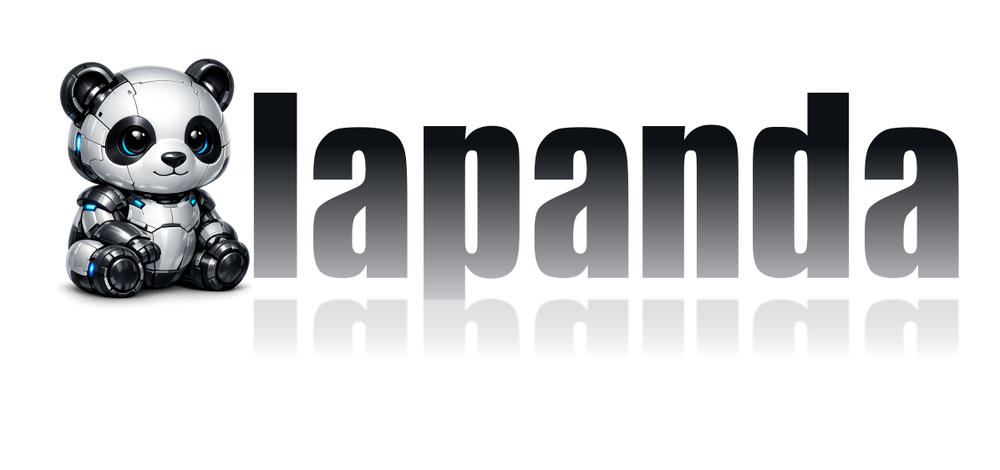
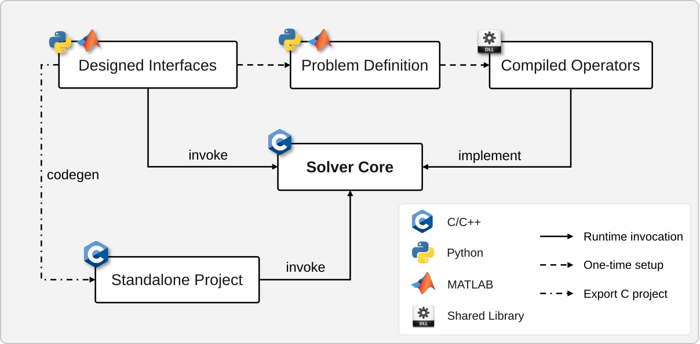
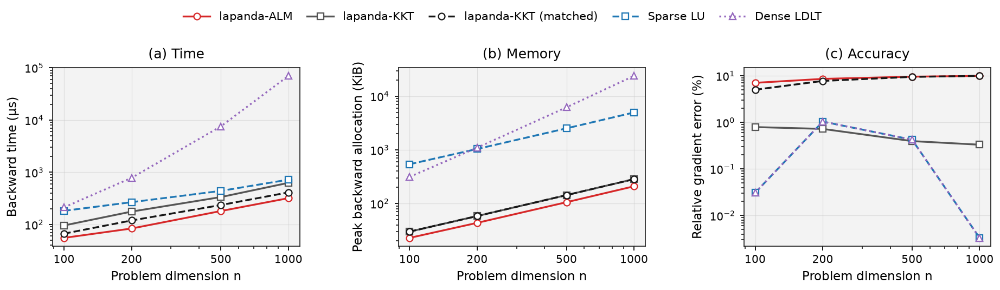
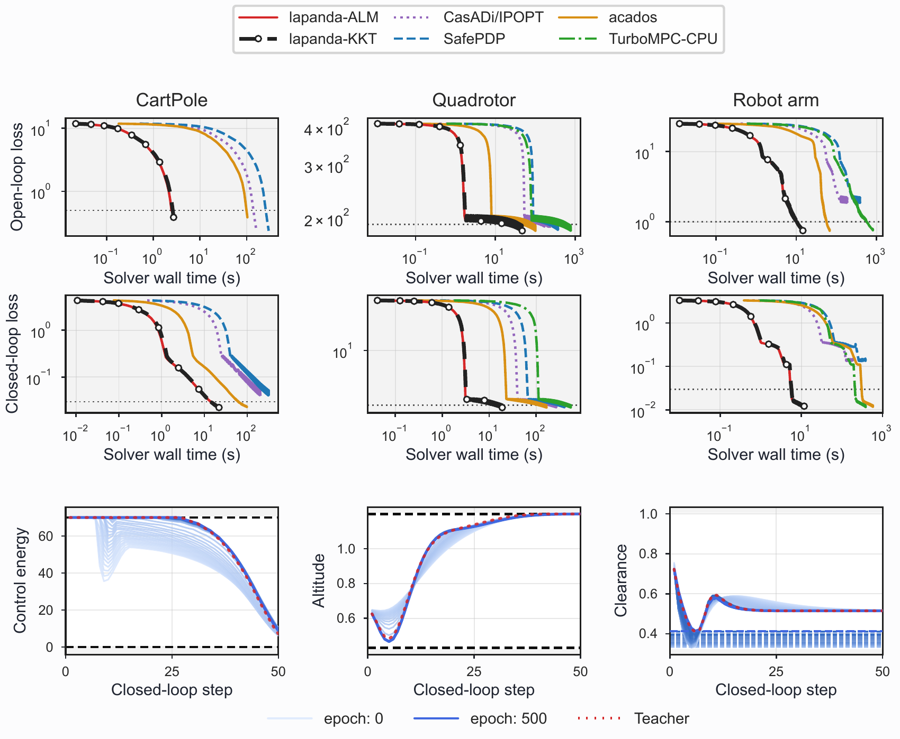
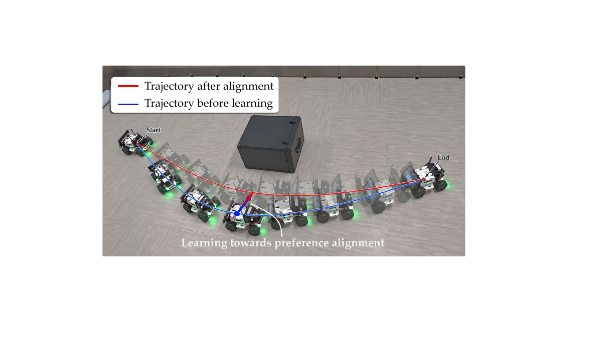
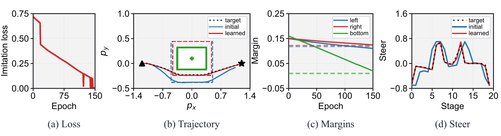

<p align="center">
  
</p>

<h1 align="center">lapanda v1.1</h1>

**lapanda** is a differentiable solver framework for constrained nonlinear optimization.  It combines an augmented Lagrangian outer loop with a PANDA projected inner solver, supports CasADi problem descriptions, and exposes Python, MATLAB, and standalone C workflows. Its backward pass provides two matrix-free strategies: original-KKT MINRES and final-subproblem CG.

The repository contains the solver runtime, user interfaces, embedded export utilities, and the paper experiments. The Python distribution and import name are both `lapanda`.

<p align="center">
  
</p>

<p align="center"><em>Software architecture and multi-platform workflow.</em></p>

[Overview](#project-summary) · [Installation](#installation) · [Backward strategies](#backward-strategies) · [Results](#results) · [Reproduction](#experiment-reproduction)

## Project Summary

lapanda targets problems of the form

```text
minimize_u   f(u, theta)
subject to   u in U
             c_lower <= c(u, theta, variable) <= c_upper
```

with an optional outer loss `L(u*, theta, variable)` for differentiating through the solution.  Simple variable bounds are handled through a projection operator, while general nonlinear constraints are handled by the augmented Lagrangian layer.  The backward pass returns the gradient of the outer loss with respect to the learnable parameters.

The current implementation provides:

- C implementations of PANDA and the augmented Lagrangian outer solver.
- Python bindings through pybind11.
- CasADi-based Python and MATLAB problem construction.
- A compiled backend that generates CasADi C oracles and loads them from the
  Python solver.
- Standalone C export for embedded or ROS-style deployment.
- Paper experiments for nonconvex Rosenbrock constraints, constrained OCP
  imitation learning, and embedded obstacle avoidance.

## File Structure

```text
alm/                         augmented Lagrangian solver core
panda/                       PANDA solver core
include/                     public C headers
adapters/casadi_static/      static adapter for exported CasADi C oracles
python/lapanda/              public Python user API
python/src/                  pybind11 C++ bindings
matlab/                      MATLAB CasADi-to-MEX interface
experiments/
  paper/                    current paper experiment entry points
  exp1_rosenbrock_smooth_constraints/  paper Exp.1 nonconvex constrained Rosenbrock
  exp2_OCPs/                 paper Exp.2 constrained OCP imitation learning
  exp3_embedded_export/      paper Exp.3 embedded obstacle avoidance
tutorials/                   Python notebook, MATLAB, and C usage examples
results/                     retained paper data and run settings
runs/                        new experiment outputs (generated)
exports/                     standalone/ROS bundles (generated)
docs/                        documentation and result figures
```

## Installation

lapanda's default solver path uses generated CasADi C oracles and native C code.  Installing the solver and using the full compiled backend therefore requires both CMake and a working C/C++ compiler.

Please make sure the following commands are available from your terminal:

```powershell
cmake --version
```

On Linux/macOS, also check:

```bash
cc --version
```

On Windows, use one of the following compiler setups:

- Visual Studio Build Tools with the C++ workload.
- MinGW-w64, with `mingw32-make` and the compiler `bin` directory added to
  `PATH`.

If CMake is missing:

1. Install CMake from <https://cmake.org/download/>.
2. During installation, enable the option that adds CMake to `PATH`.
3. Restart the terminal and run `cmake --version`.

If a compiler is missing on Windows:

1. Install Visual Studio Build Tools, or install MinGW-w64.
2. Add the compiler `bin` directory to the system `PATH`.
3. Restart the terminal and verify that `gcc --version` or the Visual Studio
   compiler tools are visible.

### Python Interface

Requirements:

- Python 3.8 or newer.
- Python packages: `casadi`, `numpy`, `pybind11`, `scikit-build-core`.
- For the notebook tutorial: `jupyter`, `matplotlib`.

From the repository root:

```powershell
cd <path-to>/lapanda

python -m pip install -e .
```

Verify:

```powershell
python -c "import lapanda; import lapanda._lapanda as m; print(lapanda.__file__); print(m.__name__)"
python -m pip show lapanda
```

Expected import name:

```python
import lapanda
```

The default Python backend is `compiled`, which generates a CasADi C oracle under `.lapanda_cache` and builds it with CMake. Use `backend="callback"` for small debugging problems when you do not want code generation.

### MATLAB Interface

Requirements:

- MATLAB with MEX support.
- CasADi for MATLAB on the MATLAB path.
- CMake and a compiler supported by MATLAB MEX.

Add the lapanda MATLAB interface and CasADi to the path:

```matlab
repo = '<path-to>/lapanda';
addpath(fullfile(repo, 'matlab'));
addpath('<path-to-your-CasADi-MATLAB-directory>'); % contains +casadi/
```

Then construct a `problem` struct and call:

```matlab
solver = lapanda_create_solver(problem, fullfile(tempdir, 'lapanda_demo'));
result = solver.solve_lapanda(x0, theta, variable, constraint_lower, constraint_upper, options);
```

See `tutorials/matlab_minimal.m` for a complete minimal example.

MATLAB uses a flat options struct: PANDA fields are `solver_max_iterations`,
`solver_tolerance`, `solver_buffer_size`, and `solver_max_stable_iter` (not
`inner_*`). ALM fields use `alm_*`, and backward fields use `backward_*`.
`solve_alm` remains an alias for `solve_lapanda`. The current MATLAB MEX uses
the subproblem CG backward path; Python's `backward.system` selection and the
new split-source build options are not exposed by this MATLAB interface.

## Usage Examples

Minimal examples are kept in `tutorials/`:

```text
tutorials/python_learning.ipynb   Python parameter-learning tutorial
tutorials/matlab_minimal.m        MATLAB CasADi/MEX workflow
tutorials/c_export_minimal.md     standalone C export and build workflow
```

Run the Python tutorial notebook:

```powershell
jupyter notebook tutorials\python_learning.ipynb
```

The notebook builds a small nonlinear constrained problem, differentiates an outer loss through the lapanda solution, and learns the parameter vector `theta` to match a demonstration.

## Backward Strategies

Both strategies use automatic-differentiation matrix–vector products and Krylov iterations without assembling the sensitivity matrix. They share the same ALM/PANDA forward solver.

| Strategy | Sensitivity target | Main properties |
| --- | --- | --- |
| `lapanda-ALM` | Final ALM subproblem, with the incoming multiplier held fixed | Smaller primal system; locally positive definite under the stated regularity assumptions; supports CG; introduces finite-penalty bias. |
| `lapanda-KKT` | Original active-set KKT conditions | Larger symmetric indefinite primal–dual system; solved by MINRES; avoids the additional finite-penalty approximation. |

Select the backward strategy through the public Python interface:

```python
from lapanda import BackwardOptions

backward = BackwardOptions()
backward.enable = True
backward.tolerance = 1e-3

# lapanda-ALM
backward.system = "subproblem"
backward.linear_solver = "cg"

# For lapanda-KKT, use these two settings instead:
# backward.system = "original_kkt"
# backward.linear_solver = "minres"

result = solver.solve_lapanda(
    x0, theta, variable, constraint_lower, constraint_upper,
    inner_solver_options=inner_options,
    alm_options=alm_options,
    backward_options=backward,
)
```

Forward accuracy and iterative linear-solve accuracy affect both strategies. The subproblem strategy also has finite-penalty bias, so a small linear residual alone does not certify an accurate original-problem gradient.

## Results

### Constrained Rosenbrock: backward cost and accuracy



The five methods use identical saved forward points. Curves report medians over five held-out starts per dimension. `lapanda-ALM` and fixed-tolerance `lapanda-KKT` use `1e-2`; the matched KKT setting is calibrated on two separate starts to approach the ALM gradient error. Sparse and dense direct solves retain their achieved accuracy.

At **n = 1000**:

| Method | Backward time (µs) | Peak backward allocation (KiB) | Gradient error (%) |
| --- | ---: | ---: | ---: |
| lapanda-ALM | 320.0 | 209.2 | 9.9553 |
| lapanda-KKT | 628.6 | 284.6 | 0.3317 |
| lapanda-KKT (matched) | 412.6 | 284.6 | 9.9786 |
| Sparse LU | 723.3 | 4,977.2 | 0.0033 |
| Dense LDLT | 70,090.5 | 23,960.4 | 0.0033 |

These operating points illustrate the subproblem strategy's smaller backward workspace and an accuracy–cost trade-off. The original-KKT strategy is useful when the finite-penalty approximation is too coarse; relative speed also depends on conditioning and the requested accuracy. See the [full numerical results](results/rosenbrock/main/summary.csv) and [MINRES calibration](results/rosenbrock/main/selected_tolerances.csv).

### Constrained OCP imitation learning



The top row shows open-loop learning from 32 initial conditions; the middle row shows closed-loop learning over 50 MPC steps. The bottom row shows representative constraint trajectories during learning.

All tasks use horizon **N = 20**, with **800 open-loop / 500 closed-loop updates** and warm starts. Requested forward tolerances are **1e-4 for CartPole and Quadrotor** and **1e-5 for Robot arm**; both native backward tolerances are **1e-3**, and `lapanda-ALM` uses the returned penalty directly.

The following table reports **cumulative complete solver-call wall time (s) | complete-solver memory (MiB)** at the first recorded target-loss crossing. Solver-specific backward settings differ, so this is a task-level comparison. Timing excludes problem construction, compilation and outer learning calculations; memory includes problem/solver construction and the first complete solve.

| Task | Target loss | lapanda-ALM | lapanda-KKT | CasADi/IPOPT | SafePDP | acados | TurboMPC-CPU |
| --- | ---: | ---: | ---: | ---: | ---: | ---: | ---: |
| CartPole/OL | 0.5 | 2.5 &#124; 3.7 | 2.6 &#124; 3.6 | 138.6 &#124; 58.7 | 255.3 &#124; 56.7 | 99.0 &#124; 60.3 | — |
| CartPole/CL | 0.03 | 14.0 &#124; 3.8 | 14.0 &#124; 3.5 | NR &#124; 59.1 | NR &#124; 56.3 | 61.3 &#124; 60.0 | — |
| Quadrotor/OL | 190 | 18.7 &#124; 5.0 | 19.3 &#124; 4.8 | 130.9 &#124; 60.7 | 210.6 &#124; 57.5 | 47.0 &#124; 61.0 | 342.9 &#124; 275.9 |
| Quadrotor/CL | 2.3 | 12.8 &#124; 3.6 | 13.4 &#124; 3.6 | 187.7 &#124; 60.6 | 288.7 &#124; 56.2 | 113.3 &#124; 59.5 | 396.4 &#124; 276.5 |
| Robot arm/OL | 1 | 10.0 &#124; 4.7 | 10.2 &#124; 4.8 | NR &#124; 59.2 | NR &#124; 56.8 | 56.6 &#124; 59.8 | 564.9 &#124; 275.4 |
| Robot arm/CL | 0.03 | 5.5 &#124; 3.8 | 5.7 &#124; 3.8 | NR &#124; 59.2 | NR &#124; 56.3 | 305.7 &#124; 60.1 | 209.5 &#124; 277.4 |

**NR** means the target was not reached during the prescribed run; **—** means unsupported. TurboMPC's tested configurations do not directly support CartPole's non-point-wise control-energy constraint. Both lapanda strategies reach all six targets, with complete-solver memory of **3.5–5.0 MiB** in these measurements. Their shared forward work explains why total costs can be close even when backward costs differ. Full curves, per-call times, gradient checks and memory measurements are retained in [results/learning](results/learning); TurboMPC-GPU results are included there separately.

### Embedded obstacle avoidance

<p align="center">
  
</p>

The standalone C export is evaluated on a **Jetson Orin Nano CPU** with circular and rectangular obstacle-avoidance tasks.

| Task | Method | Forward time (ms) | Backward time (ms) | Memory (MB) |
| --- | --- | ---: | ---: | ---: |
| Circle | lapanda | 1.76 | 0.16 | 2.16 |
| Circle | acados | 3.27 | 0.24 | 4.52 |
| Rectangle | lapanda | 55.50 | 1.13 | 2.60 |
| Rectangle | acados | — | — | — |

The recorded acados rectangular-MPCC run did not succeed. A separate smooth rectangular formulation is evaluated in [results/embedded/smooth_rectangle](results/embedded/smooth_rectangle).



The panels show imitation loss, the planned trajectory, learned margins and steering controls. The original device-level summary and recorded trajectories are retained in [results/embedded](results/embedded); raw device timing and memory logs are not included.

## Experiment Reproduction

Install the solver as above, then install the experiment dependencies:

```bash
python -m pip install -r requirements-experiments.txt
```

The current paper entry points are under `experiments/paper/`. Problem definitions, original training loops and deployment utilities remain in the original experiment directories. Published data are read from `results/`; new runs write to `runs/`.

### Rosenbrock ablation

```bash
python -m experiments.paper.run_rosen
python -m experiments.paper.run_rosen --memory
python -m experiments.paper.plot_rosen
```

The comparison replays the retained forward points and selected MINRES tolerances. Original-NLP reference checks and calibration records accompany the [saved inputs](results/rosenbrock/main).

### OCP learning

```bash
python -m experiments.paper.train --model cartpole --protocol open --method lapanda-alm
python -m experiments.paper.train --model cartpole --protocol open --method lapanda-kkt
python -m experiments.paper.plot_learning
```

Models: `cartpole`, `quadrotor`, `robot_arm`. Protocols: `open`, `closed`. Methods: `lapanda-alm`, `lapanda-kkt`, `casadi`, `safepdp`, `acados`, `turbompc-cpu`, `turbompc-gpu`.

Use `--epochs 2` for a short run. `--memory-only` measures construction and first-call RSS increments in a separate process. Recorded solver-call wall time and full training wall time are reported separately.

For a fresh checkout without the SafePDP dependency, prepare the original patched upstream code:

```bash
git clone https://github.com/wanxinjin/Safe-PDP.git external/Safe-PDP
git -C external/Safe-PDP apply ../safepdp-lapanda.patch
```

acados requires its installation path in `ACADOS_SOURCE_DIR` and its libraries on the system library path. TurboMPC requires `TURBOMPC_SOURCE_DIR` and the corresponding JAX/CPU or CUDA/cuDSS environment. These optional dependencies are only needed for their respective baselines.

### Embedded export

```bash
python experiments/exp3_embedded_export/circle/export_circle_ros_project.py --force
python experiments/exp3_embedded_export/rectangle/export_rectangle_ros_project.py --force
python experiments/exp3_embedded_export/export_acados_bundles.py --force
```

These commands generate standalone C and ROS bundles under `exports/`. The runtime measurements above were collected on the embedded device.

### Supplementary experiments

| Experiment | Command | Retained data |
| --- | --- | --- |
| Penalty, backward tolerance and conditioning | `python -m experiments.paper.run_conditioning_sensitivity_v2` | [sensitivity](results/sensitivity) |
| Forward residual effects | `python -m experiments.paper.run_forward_residual_sensitivity` | [sensitivity](results/sensitivity) |
| PANDA/PANOC within the same ALM framework | `python -m experiments.paper.run_inner` | [inner_solvers](results/inner_solvers) |
| CG preconditioning | `python -m experiments.paper.run_preconditioning --study cg` | [preconditioning/cg](results/preconditioning/cg) |
| MINRES preconditioning | `python -m experiments.paper.run_preconditioning --study minres` | [preconditioning/minres](results/preconditioning/minres) |
| Batch-gradient accuracy | `python -m experiments.paper.run_accuracy --model cartpole --protocol open --method lapanda-alm` | [gradient summary](results/learning/gradient_summary.csv) |
| Per-step MPC timing | `python -m experiments.paper.plot_mpc` | [mpc](results/mpc) |
| Discretization scaling | `python -m experiments.exp2_OCPs.run_nonlinear_horizon_scaling` | [horizon](results/horizon) |
| Smooth rectangular obstacle | `python -m experiments.paper.run_smooth_rectangle_retest` | [smooth_rectangle](results/embedded/smooth_rectangle) |

The [experiment index](results/index.csv) and [data notes](results/README.md) describe the retained measurements, reference-gradient definitions and memory boundaries.

### C library tests

```bash
cmake -S . -B build -DCMAKE_BUILD_TYPE=Release -DBUILD_TESTING=ON
cmake --build build -j
ctest --test-dir build --output-on-failure
```

## API Reference

<details>
<summary>Problem description, solver options and solve calls</summary>


### Problem Description

Python and MATLAB users describe a problem with these symbolic fields:

| Field | Meaning | Required |
| --- | --- | --- |
| `u` | decision vector | yes |
| `theta` | learnable/runtime parameter vector | yes |
| `variable` | extra runtime data, such as initial state or target | yes, can be empty |
| `cost` | smooth inner objective `f(u, theta, variable)` | yes |
| `box_lower`, `box_upper` | simple bounds defining the projection set `U` | optional |
| `constraints` | general nonlinear constraints `c(u, theta, variable)` | required for lapanda/ALM |
| `outer_loss` | scalar loss differentiated through the solution | required for backward computation |

### `build_solver`

```python
solver = lapanda.build_solver(
    problem,
    backend="compiled",
    name="lapanda_oracle",
    cache_dir=None,
    force=False,
    build=True,
    cmake_generator=None,
    split_sources=True,
    build_jobs=None,
)
```

| Argument | Meaning |
| --- | --- |
| `backend` | `"compiled"` generates and builds a CasADi C oracle; `"callback"` uses Python callbacks for debugging |
| `name` | generated oracle/library name for the compiled backend |
| `cache_dir` | directory for generated C code and build files; default is `.lapanda_cache` |
| `force` | regenerate and rebuild even when a cached oracle exists |
| `build` | `False` generates sources only; solve calls require a built library |
| `cmake_generator` | optional CMake generator string, e.g. `"Ninja"` or a Visual Studio generator |
| `split_sources` | compile separate operator C files; `False` uses a single translation unit |
| `build_jobs` | positive integer compiler-job limit; `None` uses up to four jobs |

### `SolverOptions`

These options control PANDA inner iterations.

| Option | Meaning | Typical value |
| --- | --- | --- |
| `max_iterations` | maximum PANDA iterations | `1000`-`4000` |
| `tolerance` | residual tolerance for the projected fixed-point residual | `1e-3` to `1e-6` |
| `buffer_size` | L-BFGS correction history size | `10` |
| `minimum_gamma` | positive lower bound for the adaptive step size; Python default `1e-8`; lower it if needed for high-curvature objectives | `1e-6` to `1e-8` |
| `max_stable_iter` | number of stable PANDA iterations used before checking whether the step size can be increased; set `0` to disable this check | `80`-`120` |
| `verbose` | kept for API compatibility; CSV tracing is disabled | `0` |

### `AlmOptions`

These options control the augmented Lagrangian outer loop.

| Option | Meaning | Typical value |
| --- | --- | --- |
| `max_iterations` | maximum ALM outer iterations | `20` or `100` |
| `tolerance` | ALM residual/constraint tolerance | `1e-3` to `1e-6` |
| `initial_penalty` | initial penalty `rho_0` | problem dependent |
| `penalty_update_factor` | multiplier for penalty updates | `5` or `10` |
| `max_penalty` | penalty cap; `0.0` means uncapped | `0.0` or `1e8` |
| `sufficient_decrease_factor` | residual decrease test parameter | `0.25` |
| `warm_start_inner` | reuse current solution when moving between ALM subproblems | `True` |
| `verbose` | kept for API compatibility | `0` |

### `BackwardOptions`

These options control the residual-based backward solve.

| Option | Meaning | Typical value |
| --- | --- | --- |
| `enable` | compute `dL/dtheta` when `True` | `True` |
| `tolerance` | backward linear-solver residual tolerance | `1e-3` in the OCP experiments |
| `max_iterations` | maximum backward iterations | `200`-`800` |
| `system` | sensitivity target: `subproblem` or `original_kkt` (compiled backend) | `subproblem` |
| `linear_solver` | Krylov method: `cg`, `minres`, `gmres`, or `auto`; CG falls back to MINRES on failure | `cg` |
| `restart` | restarted-GMRES subspace dimension; ignored by CG/MINRES | `40` |
| `constraint_penalty_scale` | scale applied to the final ALM penalty only in backward constraint callbacks | `1` or `10` |
| `constraint_penalty_max` | cap for the scaled backward penalty; `0.0` means uncapped | `0.0` or `1e6` |

`system="original_kkt"` applies to compiled ALM solves and requires
`linear_solver="minres"` or `"auto"`, with `constraint_penalty_scale=1.0`.
The callback backend implements subproblem differentiation; use the compiled
backend for the original-KKT strategy. The option tables above describe Python;
MATLAB uses the separate flat struct described in its tutorial.

### Solve Calls

Plain PANDA for box/simple projected problems:

```python
result = solver.solve_panda(
    x0, theta, variable,
    solver_options=inner_options,
    backward_options=backward_options,
)
```

lapanda for general nonlinear constraints:

```python
result = solver.solve_lapanda(
    x0, theta, variable,
    constraint_lower, constraint_upper,
    inner_solver_options=inner_options,
    alm_options=alm_options,
    backward_options=backward_options,
    multiplier0=None,
    penalty0=None,
    adjoint0=None,
)
```

Here `multiplier0` and `penalty0` are optional ALM warm starts. When provided, both should be vectors with the same length as the general constraint vector.
`adjoint0` is currently accepted for compatibility but ignored; it does not
warm-start the backward solve. For a separate backward evaluation at a saved
forward point, the compiled solver provides `backward_lapanda_at_solution`.

Important result fields include `solution`, `grad_theta`, `multipliers`,`penalties`, `forward_time_sec`, `backward_time_sec`, `iterations`,`inner_iterations`, `final_residual`, `backward_iterations`, and `backward_residual`. Backward-enabled calls additionally report `backward_solver_used`, `backward_fallback_used`, and `backward_peak_workspace_bytes`.

#### Oracle compilation

Compiled solvers generate each CasADi operator in a separate C file and build
with up to four parallel compiler jobs by default. Derivative products use
directional AD rather than constructing symbolic Jacobians before multiplying.
These changes are independent of the problem's stage or constraint structure;
the library ABI and forward/backward calls remain unchanged.

```python
solver = build_solver(problem, split_sources=True, build_jobs=4)
```

Use `split_sources=False` for a single translation unit or `build_jobs=1` to
limit compiler memory use. Cached libraries are reused; the new code-generation
version and source layout use separate cache entries, so existing models rebuild
once after upgrading. Metadata lists the sources used by CMake. A standalone
combined C file is also retained for compatibility; compile either that file or
the split sources, not both. Exported C projects use the split sources as well.

Compilation benefits depend on graph structure and available resources. Splitting
does not subdivide an individual large operator and can increase generated code
and library size.

</details>
